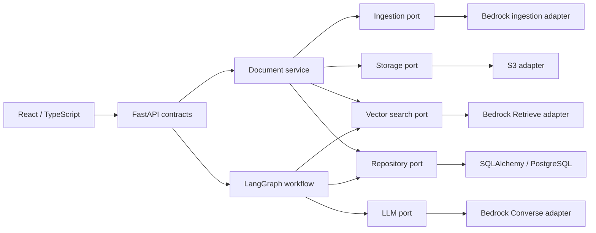

# Architecture

`aws_rag` is a single-user document Q&A proof of concept with explicit ports and adapters.
It has no authentication or tenant isolation. `owner_id = single-user` is server-assigned metadata,
not a security boundary. Keep access on localhost or behind an authenticated private gateway.

The composition root is `app/core/dependencies.py`; the cloud factory is `app/providers/factory.py`.
Routers, domain objects, repository code, services, and graph nodes never import provider implementations.
AWS SDK imports are restricted to AWS adapter code (and adapter/integration tests).
Ports use synchronous methods; synchronous FastAPI endpoints and `run_in_threadpool` keep blocking SDK/SQL
calls off the event loop. A per-request SQLAlchemy session/transaction belongs to each repository operation.

## Document lifecycle

1. Read at most the upload limit plus one byte; validate extension, signature/encoding, size, and filename.
   Strip filename path components; store under a UUID key. Original filenames remain display metadata.
2. Upload the document and commit metadata. If the database commit fails, attempt object deletion.
   A failed compensating deletion logs the document ID for operator reconciliation.
3. Serialize ingestion starts/status transitions using a singleton database row locked with `FOR UPDATE`.
   An in-process lock also enables SQLite unit tests. A Bedrock conflict is independently handled as queued.
4. Create `<object-key>.metadata.json` with `document_id` and `owner_id`, then start S3 data-source sync
   with the document UUID as idempotency token. An active external job leaves the document Uploaded/queued.
5. Status polling retries queued starts and checks the durable job ID. COMPLETE is only a sync result.
   Require document status INDEXED, then a nonempty retrieval filtered by the document/owner IDs before Ready.
6. FAILED, STOPPED, partial/ignored document results, or timeout produce Failed. Missing/not-yet-visible
   documents remain Processing until the configurable timeout. Transient provider errors return 503 and retry
   on the next poll. Upload-time transient ingestion errors preserve the uploaded metadata for recovery.

The browser polls while there are pending documents. There is deliberately no separate background worker;
sync continues in AWS if the browser closes, but queued starts/status reconciliation resume on the next visit
or `GET /api/documents/{id}/status`. This GET therefore has a documented reconciliation side effect.
For a future durable queue, add a scheduler around the same service rather than changing the ports or API.
Use a dedicated data source/prefix and one application database for the POC. Large upload batches are inefficient
because sync scans the data source; batch ingestion is a future optimization.

## RAG and persistence

`START → validate → retrieve → build_prompt → generate → save → END` is the same graph on either cloud.
The graph rechecks Ready server-side, applies document filters, caps context, deduplicates chunks, and assigns
source labels to actual retrieved text. JSON reference data is explicitly untrusted. A system prompt requires
grounded answers and matching citations. Unknown source labels or uncited output become an insufficient-context
answer with no citations. Valid citations link to the exact context sent to the model, not invented URLs.
This checks reference identity, not semantic entailment; model answers still need evaluation by the user.

Empty retrieval skips inference and persists a transparent `no-context` response. Successful answers are
returned only after the history transaction commits. Retrieval/model/database failures return an error and
do not persist a successful interaction. A client disconnect can happen after a commit, so check history before
retrying; request replay is not deduplicated. The graph is not checkpointed and cannot resume a half-finished
model request. No PDF OCR is performed by the app; scanned/encrypted/malformed PDFs may fail ingestion.

`documents` holds metadata, owner, status, job ID, and UTC timestamps. `question_answers` references documents
with a foreign key and stores sources as standard SQL JSON. The RDS database is only metadata/history storage.
The Bedrock vector backend is separate. `ingestion_locks` holds the singleton serialization row seeded by Alembic.

## Observability and boundaries

JSON stdout logs contain event names, correlation IDs, document IDs, status, counts, and latency.
SDK error bodies, raw tracebacks, question/answer text, and document text are excluded. SQL parameter hiding is on.
CloudWatch shipping is configured in ECS, not application code. Avoid enabling LangSmith tracing or SDK debug
logging for private documents without a separate review. `GET /api/health` is liveness; readiness checks the
migrated schema and KB/data-source configuration. It does not invoke an LLM or certify all IAM/model quotas.

Request errors use `{ "error": { "code": "...", "message": "...", "request_id": "..." } }`.
The frontend uses only `/api` and normalized models. OpenAPI is available at `/docs`.

Multi-user expansion requires verified server-side identities, authorization in every repository lookup,
retrieval ownership enforcement, authenticated upload/history routes, and isolation regression tests.
The current metadata filters are useful scaffolding but do not replace authentication.
